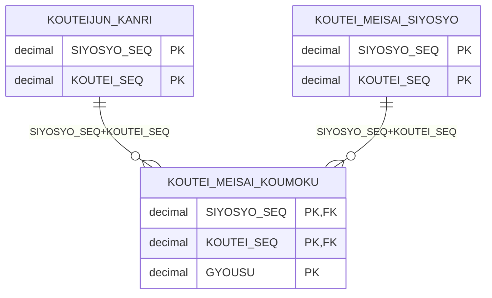
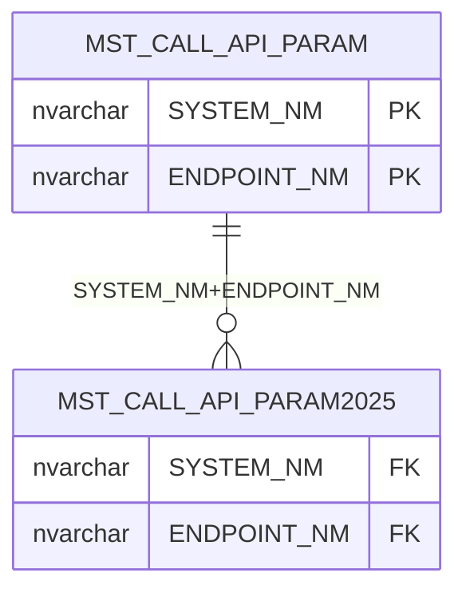
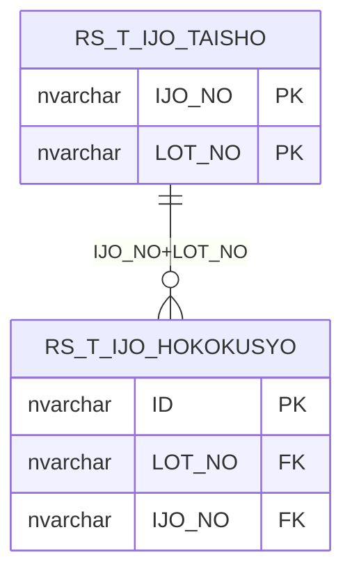
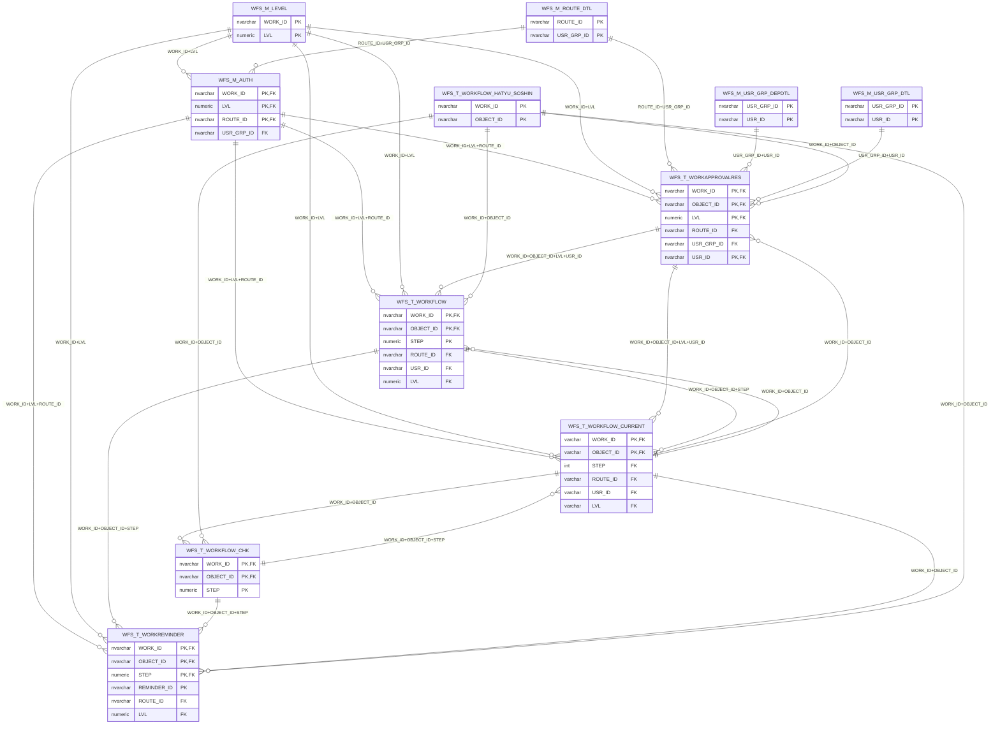

# TALON DB ER図(信頼度の高い関係のみ)

- 対象: 複合PKが全一致した関係(multi-col)のみ。FK制約はDB未定義のため、列名からの機械推定。
- 表記: `親 ||--o{ 子`。属性は PK と、関係に使われる FK 列のみ表示(全列は `テーブル定義.md`)。
- 単一列PKの推定(single-col)は偶然一致が多いため、実コードとの突き合わせ後に追加する。

| 系統 | 関係数 | テーブル数 |
|---|---|---|
| KOUTEI_工程系 | 2 | 3 |
| NP_日報系 | 9 | 12 |
| OTHER_その他 | 1 | 2 |
| RS_クレーム異常系 | 1 | 2 |
| SIYO_仕様書系 | 13 | 14 |
| TLN_TALON基盤系 | 54 | 23 |
| WFS_ワークフロー系 | 27 | 11 |
| (系統間) | 21 | - |

## KOUTEI_工程系

## NP_日報系

```mermaid
erDiagram
    NP_T_CHEK_SHEET ||--o{ NP_T_HATSUMONO_INPUT : "LOT_NO+KOTEI_JUN"
    NP_T_INPUT_ITAATSU_HINMOKU_MEISAI ||--o{ NP_T_INPUT_COMMON : "KBN+HINMOKU_CD+LOT_NO"
    NP_T_KIZAI_SAISAKU ||--o{ NP_T_KIZAI : "LOT_NO+SOUKOUSEI_HINMOKU_NAME+KIZAI_LOT_NO"
    NP_T_KIZAI_SAISAKU ||--o{ NP_T_KIZAI_HARAIDASHI : "LOT_NO+SOUKOUSEI_HINMOKU_NAME+KIZAI_LOT_NO"
    NP_T_KIZAI_SAISAKU ||--o{ NP_T_KIZAI_HARAIDASHI33 : "LOT_NO+SOUKOUSEI_HINMOKU_NAME+KIZAI_LOT_NO"
    NP_T_TEHAI_RENKEI_KANRI ||--o{ NP_T_INPUT_COMMON : "LOT_NO+SAGYO_KU"
    NP_T_TEHAI_RENKEI_KANRI ||--o{ NP_T_INPUT_GAIKEI : "LOT_NO+SAGYO_KU"
    NP_T_TEHAI_RENKEI_KANRI ||--o{ NP_T_MOKUSHI : "LOT_NO+SAGYO_KU"
    NP_T_TEHAI_RENKEI_KANRI ||--o{ NP_T_TEHAI_JOHO : "LOT_NO+SAGYO_KU"
    NP_T_CHEK_SHEET {
        nvarchar LOT_NO PK
        numeric KOTEI_JUN PK
    }
    NP_T_HATSUMONO_INPUT {
        nvarchar LOT_NO FK
        nvarchar KOTEI_JUN FK
        nvarchar ID PK
    }
    NP_T_INPUT_COMMON {
        nvarchar ID PK
        nvarchar LOT_NO FK
        nvarchar HINMOKU_CD FK
        nvarchar SAGYO_KU FK
        nvarchar KBN FK
        nvarchar FILE_PATH FK
        nvarchar SIYOSYO_NO FK
        nvarchar RENBAN FK
    }
    NP_T_INPUT_GAIKEI {
        nvarchar ID PK
        nvarchar LOT_NO FK
        nvarchar SAGYO_KU FK
    }
    NP_T_INPUT_ITAATSU_HINMOKU_MEISAI {
        nvarchar KBN PK
        nvarchar HINMOKU_CD PK
        nvarchar LOT_NO PK
    }
    NP_T_KIZAI {
        nvarchar ID PK
        nvarchar LOT_NO FK
        nvarchar SOUKOUSEI_HINMOKU_NAME FK
        nvarchar KIZAI_LOT_NO FK
    }
    NP_T_KIZAI_HARAIDASHI {
        nvarchar LOT_NO FK
        nvarchar SOUKOUSEI_HINMOKU_NAME FK
        nvarchar KIZAI_LOT_NO FK
        nvarchar KIZAI_ID PK
    }
    NP_T_KIZAI_HARAIDASHI33 {
        nvarchar LOT_NO FK
        nvarchar SOUKOUSEI_HINMOKU_NAME FK
        nvarchar KIZAI_LOT_NO FK
    }
    NP_T_KIZAI_SAISAKU {
        nvarchar LOT_NO PK
        nvarchar SOUKOUSEI_HINMOKU_NAME PK
        nvarchar KIZAI_LOT_NO PK
    }
    NP_T_MOKUSHI {
        nvarchar ID PK
        nvarchar LOT_NO FK
        nvarchar SAGYO_KU FK
    }
    NP_T_TEHAI_JOHO {
        nvarchar LOT_NO PK,FK
        nvarchar TEHAI_DVS PK
        nvarchar SAGYO_KU PK,FK
        date NOUKI_DT PK
        numeric TOUNYU_PCS_SUU PK
        nvarchar KANNOU_DVS PK
    }
    NP_T_TEHAI_RENKEI_KANRI {
        nvarchar LOT_NO PK,FK
        nvarchar SAGYO_KU PK
        numeric JYUCHU_NO FK
    }
```

## OTHER_その他

## RS_クレーム異常系

## SIYO_仕様書系

```mermaid
erDiagram
    SIYO20010 ||--o{ SIYO_CHK_DATA_MEISAI : "SIYOSYO_NO+FILE_PATH"
    SIYO20012 ||--o{ SIYO2001 : "SIYOSYO_NO+TEXT"
    SIYO4001 ||--o{ SIYO4002 : "SIYOSYO_NO+CHK_ID"
    SIYO4001 ||--o{ SIYO_CHK_DATA_MEISAI : "SIYOSYO_NO+CHK_ID"
    SIYOM010 ||--o{ SIYOM013 : "SOUSU+HYOMEN_SYORI_CD+KOUTEI_CD"
    SIYO_CHK_DATA ||--o{ SIYO4002 : "SIYOSYO_NO+CHK_ID"
    SIYO_CHK_DATA ||--o{ SIYO_CHK_DATA_MEISAI : "SIYOSYO_NO+CHK_ID"
    SIYO_SEIZO_JKN ||--o{ SIYO_SEIZO_JKN_MEISAI : "SIYOSYO_SEQ+KOUTEI_SEQ"
    SIYO_SEIZO_JKN ||--o{ SIYO_SEIZO_JKN_MEISAI2 : "SIYOSYO_SEQ+KOUTEI_SEQ"
    SIYO_SEIZO_JKN ||--o{ SIYO_SEIZO_JKN_MEISAI3 : "SIYOSYO_SEQ+KOUTEI_SEQ"
    SIYO_SEIZO_JKN_HEADER ||--o{ SIYO_SEIZO_JKN_MEISAI : "SIYOSYO_SEQ+KOUTEI_SEQ"
    SIYO_SEIZO_JKN_HEADER ||--o{ SIYO_SEIZO_JKN_MEISAI2 : "SIYOSYO_SEQ+KOUTEI_SEQ"
    SIYO_SEIZO_JKN_HEADER ||--o{ SIYO_SEIZO_JKN_MEISAI3 : "SIYOSYO_SEQ+KOUTEI_SEQ"
    SIYO2001 {
        nvarchar SIYOSYO_NO PK,FK
        nvarchar BLOCK_ID PK
        nvarchar TEXT FK
    }
    SIYO20010 {
        nvarchar SIYOSYO_NO PK
        nvarchar FILE_PATH PK
    }
    SIYO20012 {
        nvarchar SIYOSYO_NO PK
        nvarchar TEXT PK
    }
    SIYO4001 {
        nvarchar SIYOSYO_NO PK
        nvarchar CHK_ID PK
    }
    SIYO4002 {
        nvarchar SIYOSYO_NO PK,FK
        nvarchar CHK_ID PK,FK
        nvarchar MEISAI_ID PK
    }
    SIYOM010 {
        numeric SOUSU PK
        nvarchar HYOMEN_SYORI_CD PK
        nvarchar KOUTEI_CD PK
    }
    SIYOM013 {
        numeric SOUSU PK,FK
        nvarchar HYOMEN_SYORI_CD PK,FK
        nvarchar KOUTEI_CD PK,FK
        nvarchar SIYO_IVH_FLG PK
    }
    SIYO_CHK_DATA {
        nvarchar SIYOSYO_NO PK
        nvarchar CHK_ID PK
    }
    SIYO_CHK_DATA_MEISAI {
        nvarchar SIYOSYO_NO PK,FK
        nvarchar MEISAI_ID PK
        nvarchar CHK_ID PK,FK
        nvarchar FILE_PATH FK
    }
    SIYO_SEIZO_JKN {
        decimal SIYOSYO_SEQ PK
        decimal KOUTEI_SEQ PK
    }
    SIYO_SEIZO_JKN_HEADER {
        decimal SIYOSYO_SEQ PK
        decimal KOUTEI_SEQ PK
    }
    SIYO_SEIZO_JKN_MEISAI {
        decimal SIYOSYO_SEQ PK,FK
        decimal KOUTEI_SEQ PK,FK
        int GYOSU PK
    }
    SIYO_SEIZO_JKN_MEISAI2 {
        decimal SIYOSYO_SEQ PK,FK
        decimal KOUTEI_SEQ PK,FK
        int GYOSU PK
    }
    SIYO_SEIZO_JKN_MEISAI3 {
        decimal SIYOSYO_SEQ PK,FK
        decimal KOUTEI_SEQ PK,FK
        int GYOSU PK
    }
```

## TLN_TALON基盤系

```mermaid
erDiagram
    TLN_B_GENERAL_APP ||--o{ TLN_B_GENERAL_ITEM_OPTN : "BRANCHES_ID+FUNC_ID+FUNC_SEQ+FUNC_KBN"
    TLN_B_GENERAL_APP ||--o{ TLN_B_GENERAL_USES : "BRANCHES_ID+FUNC_ID+FUNC_SEQ+FUNC_KBN"
    TLN_B_GENERAL_FUNC ||--o{ TLN_B_GENERAL_APP : "BRANCHES_ID+FUNC_ID"
    TLN_B_GENERAL_FUNC ||--o{ TLN_B_GENERAL_AUTH : "BRANCHES_ID+FUNC_ID"
    TLN_B_GENERAL_FUNC ||--o{ TLN_B_GENERAL_FUNC_SQL : "BRANCHES_ID+FUNC_ID"
    TLN_B_GENERAL_FUNC ||--o{ TLN_B_GENERAL_ITEM : "BRANCHES_ID+FUNC_ID"
    TLN_B_GENERAL_FUNC ||--o{ TLN_B_GENERAL_ITEM_OPTN : "BRANCHES_ID+FUNC_ID"
    TLN_B_GENERAL_FUNC ||--o{ TLN_B_GENERAL_POSITION : "BRANCHES_ID+FUNC_ID"
    TLN_B_GENERAL_FUNC ||--o{ TLN_B_GENERAL_SQL_ANALYZE : "BRANCHES_ID+FUNC_ID"
    TLN_B_GENERAL_FUNC ||--o{ TLN_B_GENERAL_USES : "BRANCHES_ID+FUNC_ID"
    TLN_B_GENERAL_FUNC_SQL ||--o{ TLN_B_GENERAL_APP : "BRANCHES_ID+FUNC_ID+FUNC_SEQ"
    TLN_B_GENERAL_FUNC_SQL ||--o{ TLN_B_GENERAL_ITEM : "BRANCHES_ID+FUNC_ID+FUNC_SEQ"
    TLN_B_GENERAL_FUNC_SQL ||--o{ TLN_B_GENERAL_ITEM_OPTN : "BRANCHES_ID+FUNC_ID+FUNC_SEQ"
    TLN_B_GENERAL_FUNC_SQL ||--o{ TLN_B_GENERAL_POSITION : "BRANCHES_ID+FUNC_ID+FUNC_SEQ"
    TLN_B_GENERAL_FUNC_SQL ||--o{ TLN_B_GENERAL_SQL_ANALYZE : "BRANCHES_ID+FUNC_ID+FUNC_SEQ"
    TLN_B_GENERAL_FUNC_SQL ||--o{ TLN_B_GENERAL_USES : "BRANCHES_ID+FUNC_ID+FUNC_SEQ"
    TLN_B_GENERAL_ITEM ||--o{ TLN_B_GENERAL_FUNC_SQL : "BRANCHES_ID+FUNC_ID+FUNC_SEQ+SORT"
    TLN_B_GENERAL_ITEM ||--o{ TLN_B_GENERAL_POSITION : "BRANCHES_ID+FUNC_ID+FUNC_SEQ+SORT"
    TLN_M_FUNCTION ||--o{ TLN_B_GENERAL_AUTH : "FUNC_ATH_ID+FUNC_ID"
    TLN_M_GENERAL_APP ||--o{ TLN_ANALYZE_INFO : "FUNC_ID+FUNC_SEQ+FUNC_KBN"
    TLN_M_GENERAL_APP ||--o{ TLN_ANALYZE_INFO_LOG : "FUNC_ID+FUNC_SEQ+FUNC_KBN"
    TLN_M_GENERAL_APP ||--o{ TLN_B_GENERAL_APP : "FUNC_ID+FUNC_SEQ+FUNC_KBN"
    TLN_M_GENERAL_APP ||--o{ TLN_B_GENERAL_ITEM_OPTN : "FUNC_ID+FUNC_SEQ+FUNC_KBN"
    TLN_M_GENERAL_APP ||--o{ TLN_B_GENERAL_USES : "FUNC_ID+FUNC_SEQ+FUNC_KBN"
    TLN_M_GENERAL_APP ||--o{ TLN_M_GENERAL_ITEM_OPTN : "FUNC_ID+FUNC_SEQ+FUNC_KBN"
    TLN_M_GENERAL_APP ||--o{ TLN_M_GENERAL_USES : "FUNC_ID+FUNC_SEQ+FUNC_KBN"
    TLN_M_GENERAL_AUTH ||--o{ TLN_B_GENERAL_AUTH : "FUNC_ID+FUNC_ATH_ID"
    TLN_M_GENERAL_FUNC_SQL ||--o{ TLN_ANALYZE_INFO : "FUNC_ID+FUNC_SEQ"
    TLN_M_GENERAL_FUNC_SQL ||--o{ TLN_ANALYZE_INFO_LOG : "FUNC_ID+FUNC_SEQ"
    TLN_M_GENERAL_FUNC_SQL ||--o{ TLN_B_GENERAL_APP : "FUNC_ID+FUNC_SEQ"
    TLN_M_GENERAL_FUNC_SQL ||--o{ TLN_B_GENERAL_FUNC_SQL : "FUNC_ID+FUNC_SEQ"
    TLN_M_GENERAL_FUNC_SQL ||--o{ TLN_B_GENERAL_ITEM : "FUNC_ID+FUNC_SEQ"
    TLN_M_GENERAL_FUNC_SQL ||--o{ TLN_B_GENERAL_ITEM_OPTN : "FUNC_ID+FUNC_SEQ"
    TLN_M_GENERAL_FUNC_SQL ||--o{ TLN_B_GENERAL_POSITION : "FUNC_ID+FUNC_SEQ"
    TLN_M_GENERAL_FUNC_SQL ||--o{ TLN_B_GENERAL_SQL_ANALYZE : "FUNC_ID+FUNC_SEQ"
    TLN_M_GENERAL_FUNC_SQL ||--o{ TLN_B_GENERAL_USES : "FUNC_ID+FUNC_SEQ"
    TLN_M_GENERAL_FUNC_SQL ||--o{ TLN_M_GENERAL_APP : "FUNC_ID+FUNC_SEQ"
    TLN_M_GENERAL_FUNC_SQL ||--o{ TLN_M_GENERAL_ITEM : "FUNC_ID+FUNC_SEQ"
    TLN_M_GENERAL_FUNC_SQL ||--o{ TLN_M_GENERAL_ITEM_OPTN : "FUNC_ID+FUNC_SEQ"
    TLN_M_GENERAL_FUNC_SQL ||--o{ TLN_M_GENERAL_POSITION : "FUNC_ID+FUNC_SEQ"
    TLN_M_GENERAL_FUNC_SQL ||--o{ TLN_M_GENERAL_SQL_ANALYZE : "FUNC_ID+FUNC_SEQ"
    TLN_M_GENERAL_FUNC_SQL ||--o{ TLN_M_GENERAL_USES : "FUNC_ID+FUNC_SEQ"
    TLN_M_GENERAL_FUNC_SQL ||--o{ TLN_M_SPEC_GRAPH : "FUNC_ID+FUNC_SEQ"
    TLN_M_GENERAL_ITEM ||--o{ TLN_B_GENERAL_FUNC_SQL : "FUNC_ID+FUNC_SEQ+SORT"
    TLN_M_GENERAL_ITEM ||--o{ TLN_B_GENERAL_ITEM : "FUNC_ID+FUNC_SEQ+SORT"
    TLN_M_GENERAL_ITEM ||--o{ TLN_B_GENERAL_POSITION : "FUNC_ID+FUNC_SEQ+SORT"
    TLN_M_GENERAL_ITEM ||--o{ TLN_M_GENERAL_FUNC_SQL : "FUNC_ID+FUNC_SEQ+SORT"
    TLN_M_GENERAL_ITEM ||--o{ TLN_M_GENERAL_POSITION : "FUNC_ID+FUNC_SEQ+SORT"
    TLN_M_GENERAL_ITEM_OPTN ||--o{ TLN_ANALYZE_INFO : "FUNC_ID+FUNC_SEQ+COL_NAME+FUNC_KBN+OPT_SORT"
    TLN_M_GENERAL_ITEM_OPTN ||--o{ TLN_ANALYZE_INFO_LOG : "FUNC_ID+FUNC_SEQ+COL_NAME+FUNC_KBN+OPT_SORT"
    TLN_M_GENERAL_ITEM_OPTN ||--o{ TLN_B_GENERAL_ITEM_OPTN : "FUNC_ID+FUNC_SEQ+COL_NAME+FUNC_KBN+OPT_SORT"
    TLN_M_GENERAL_POSITION ||--o{ TLN_B_GENERAL_POSITION : "FUNC_ID+SCOPE+ATTR_KBN+POS+SORT"
    TLN_M_GENERAL_POSITION ||--o{ TLN_M_SPEC_DESIGN : "FUNC_ID+SCOPE+ATTR_KBN+POS+SORT"
    TLN_M_SPEC_GRAPH ||--o{ TLN_M_SPEC_PLOT : "FUNC_ID+BLOC_NO+SERIES_NO"
    TLN_ANALYZE_INFO {
        nvarchar FUNC_ID PK,FK
        numeric FUNC_SEQ PK,FK
        nvarchar FUNC_KBN PK,FK
        nvarchar COL_NAME PK,FK
        numeric OPT_SORT PK,FK
        nvarchar EVENT_TYPE PK
        nvarchar DATA_TYPE PK
        numeric MOCK_SEQ PK
        numeric SEQ PK
    }
    TLN_ANALYZE_INFO_LOG {
        nvarchar FUNC_ID PK,FK
        numeric FUNC_SEQ PK,FK
        nvarchar FUNC_KBN PK,FK
        nvarchar COL_NAME PK,FK
        numeric OPT_SORT PK,FK
        nvarchar EVENT_TYPE PK
        nvarchar DATA_TYPE PK
        numeric MOCK_SEQ PK
        numeric SEQ PK
    }
    TLN_B_GENERAL_APP {
        nvarchar BRANCHES_ID PK,FK
        nvarchar FUNC_ID PK,FK
        numeric FUNC_SEQ PK,FK
        nvarchar FUNC_KBN PK,FK
    }
    TLN_B_GENERAL_AUTH {
        nvarchar BRANCHES_ID PK,FK
        nvarchar FUNC_ID PK,FK
        nvarchar FUNC_ATH_ID PK,FK
    }
    TLN_B_GENERAL_FUNC {
        nvarchar BRANCHES_ID PK
        nvarchar FUNC_ID PK
    }
    TLN_B_GENERAL_FUNC_SQL {
        nvarchar BRANCHES_ID PK,FK
        nvarchar FUNC_ID PK,FK
        numeric FUNC_SEQ PK,FK
        numeric SORT FK
    }
    TLN_B_GENERAL_ITEM {
        nvarchar BRANCHES_ID PK,FK
        nvarchar FUNC_ID PK,FK
        numeric FUNC_SEQ PK,FK
        numeric SORT PK,FK
    }
    TLN_B_GENERAL_ITEM_OPTN {
        nvarchar BRANCHES_ID PK,FK
        nvarchar FUNC_ID PK,FK
        numeric FUNC_SEQ PK,FK
        nvarchar COL_NAME PK,FK
        nvarchar FUNC_KBN PK,FK
        numeric OPT_SORT PK,FK
    }
    TLN_B_GENERAL_POSITION {
        nvarchar BRANCHES_ID PK,FK
        nvarchar FUNC_ID PK,FK
        nvarchar SCOPE PK,FK
        nvarchar ATTR_KBN PK,FK
        nvarchar POS PK,FK
        numeric SORT PK,FK
        numeric FUNC_SEQ FK
    }
    TLN_B_GENERAL_SQL_ANALYZE {
        nvarchar BRANCHES_ID PK,FK
        nvarchar FUNC_ID PK,FK
        numeric FUNC_SEQ PK,FK
        nvarchar DIVISION PK
        numeric SEQ PK
        numeric SRC_SEQ PK
    }
    TLN_B_GENERAL_USES {
        nvarchar BRANCHES_ID PK,FK
        nvarchar FUNC_ID PK,FK
        numeric FUNC_SEQ PK,FK
        nvarchar FUNC_KBN PK,FK
        nvarchar USER_CODE PK
        numeric SEQ PK
        nvarchar KEY_CODE PK
    }
    TLN_M_FUNCTION {
        nvarchar FUNC_ATH_ID PK
        nvarchar FUNC_ID PK
    }
    TLN_M_GENERAL_APP {
        nvarchar FUNC_ID PK,FK
        numeric FUNC_SEQ PK,FK
        nvarchar FUNC_KBN PK
    }
    TLN_M_GENERAL_AUTH {
        nvarchar FUNC_ID PK
        nvarchar FUNC_ATH_ID PK
    }
    TLN_M_GENERAL_FUNC_SQL {
        nvarchar FUNC_ID PK,FK
        numeric FUNC_SEQ PK,FK
        numeric SORT FK
    }
    TLN_M_GENERAL_ITEM {
        nvarchar FUNC_ID PK,FK
        numeric FUNC_SEQ PK,FK
        numeric SORT PK
    }
    TLN_M_GENERAL_ITEM_OPTN {
        nvarchar FUNC_ID PK,FK
        numeric FUNC_SEQ PK,FK
        nvarchar COL_NAME PK
        nvarchar FUNC_KBN PK,FK
        numeric OPT_SORT PK
    }
    TLN_M_GENERAL_POSITION {
        nvarchar FUNC_ID PK,FK
        nvarchar SCOPE PK
        nvarchar ATTR_KBN PK
        nvarchar POS PK
        numeric SORT PK,FK
        numeric FUNC_SEQ FK
    }
    TLN_M_GENERAL_SQL_ANALYZE {
        nvarchar FUNC_ID PK,FK
        numeric FUNC_SEQ PK,FK
        nvarchar DIVISION PK
        numeric SEQ PK
        numeric SRC_SEQ PK
    }
    TLN_M_GENERAL_USES {
        nvarchar FUNC_ID PK,FK
        numeric FUNC_SEQ PK,FK
        nvarchar FUNC_KBN PK,FK
        nvarchar USER_CODE PK
        numeric SEQ PK
        nvarchar KEY_CODE PK
    }
    TLN_M_SPEC_DESIGN {
        nvarchar FUNC_ID PK,FK
        numeric DESIGN_NO PK
        nvarchar SCOPE FK
        nvarchar ATTR_KBN FK
        nvarchar POS FK
        numeric SORT FK
    }
    TLN_M_SPEC_GRAPH {
        nvarchar FUNC_ID PK,FK
        numeric FUNC_SEQ FK
        numeric BLOC_NO PK
        numeric SERIES_NO PK
    }
    TLN_M_SPEC_PLOT {
        nvarchar FUNC_ID PK,FK
        numeric PLOT_NO PK
        numeric BLOC_NO FK
        numeric SERIES_NO PK,FK
    }
```

## WFS_ワークフロー系

## 系統間の関係

| 親(系統) | 子(系統) | 結合列 |
|---|---|---|
| COM_T_TYUI_HYOJI (COM) | NP_T_TEHAI_RENKEI_KANRI (NP) | LOT_NO,JYUCHU_NO |
| COM_T_TYUI_HYOJI (COM) | SHK_T_SIJI_MEISAI (SHK) | LOT_NO,JYUCHU_NO |
| COM_T_TYUI_HYOJI (COM) | SIYO_T_SEIZOSASHIZUSYO (SIYO) | LOT_NO,JYUCHU_NO |
| KOUTEIJUN_KANRI (KOUTEI) | NP_T_KOUTEI_SINTYOKU (NP) | SIYOSYO_SEQ,KOUTEI_SEQ |
| KOUTEIJUN_KANRI (KOUTEI) | SIYO_SEIZO_JKN_MEISAI (SIYO) | SIYOSYO_SEQ,KOUTEI_SEQ |
| KOUTEIJUN_KANRI (KOUTEI) | SIYO_SEIZO_JKN_MEISAI2 (SIYO) | SIYOSYO_SEQ,KOUTEI_SEQ |
| KOUTEIJUN_KANRI (KOUTEI) | SIYO_SEIZO_JKN_MEISAI3 (SIYO) | SIYOSYO_SEQ,KOUTEI_SEQ |
| KOUTEI_MEISAI_SIYOSYO (KOUTEI) | NP_T_KOUTEI_SINTYOKU (NP) | SIYOSYO_SEQ,KOUTEI_SEQ |
| KOUTEI_MEISAI_SIYOSYO (KOUTEI) | SIYO_SEIZO_JKN_MEISAI (SIYO) | SIYOSYO_SEQ,KOUTEI_SEQ |
| KOUTEI_MEISAI_SIYOSYO (KOUTEI) | SIYO_SEIZO_JKN_MEISAI2 (SIYO) | SIYOSYO_SEQ,KOUTEI_SEQ |
| KOUTEI_MEISAI_SIYOSYO (KOUTEI) | SIYO_SEIZO_JKN_MEISAI3 (SIYO) | SIYOSYO_SEQ,KOUTEI_SEQ |
| O7ISCHEDULE (OTHER) | NP_T_TEHAI_RENKEI_KANRI (NP) | LOT_NO,JYUCHU_NO |
| O7ISCHEDULE (OTHER) | SHK_T_SIJI_MEISAI (SHK) | LOT_NO,JYUCHU_NO |
| O7ISCHEDULE (OTHER) | SIYO_T_SEIZOSASHIZUSYO (SIYO) | LOT_NO,JYUCHU_NO |
| SIYO20010 (SIYO) | NP_T_INPUT_COMMON (NP) | SIYOSYO_NO,FILE_PATH |
| SIYO20011 (SIYO) | NP_T_INPUT_COMMON (NP) | SIYOSYO_NO,RENBAN |
| SIYO20012 (SIYO) | T_SIYOSYO_COMBINED (OTHER) | SIYOSYO_NO,TEXT |
| SIYO_SEIZO_JKN (SIYO) | KOUTEI_MEISAI_KOUMOKU (KOUTEI) | SIYOSYO_SEQ,KOUTEI_SEQ |
| SIYO_SEIZO_JKN (SIYO) | NP_T_KOUTEI_SINTYOKU (NP) | SIYOSYO_SEQ,KOUTEI_SEQ |
| SIYO_SEIZO_JKN_HEADER (SIYO) | KOUTEI_MEISAI_KOUMOKU (KOUTEI) | SIYOSYO_SEQ,KOUTEI_SEQ |
| SIYO_SEIZO_JKN_HEADER (SIYO) | NP_T_KOUTEI_SINTYOKU (NP) | SIYOSYO_SEQ,KOUTEI_SEQ |
