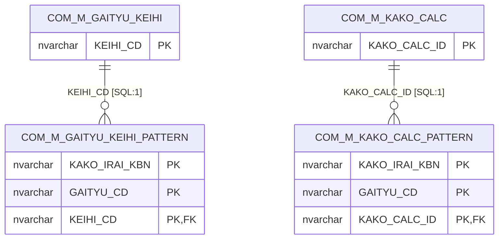
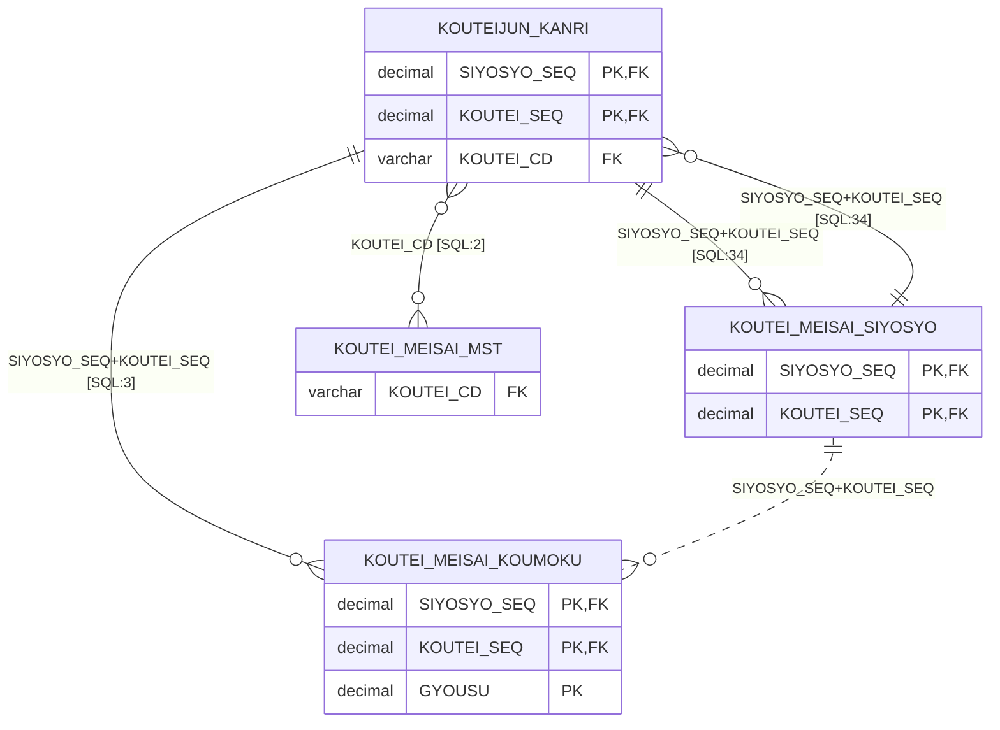
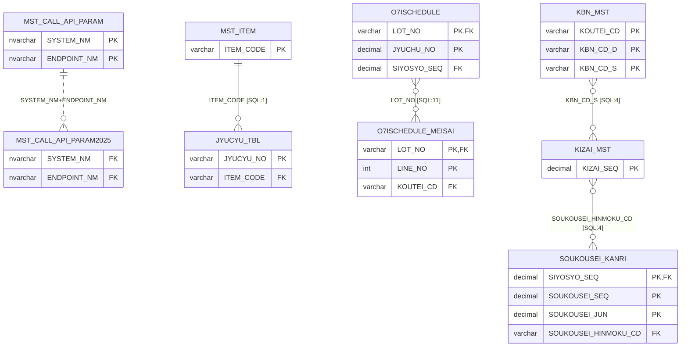
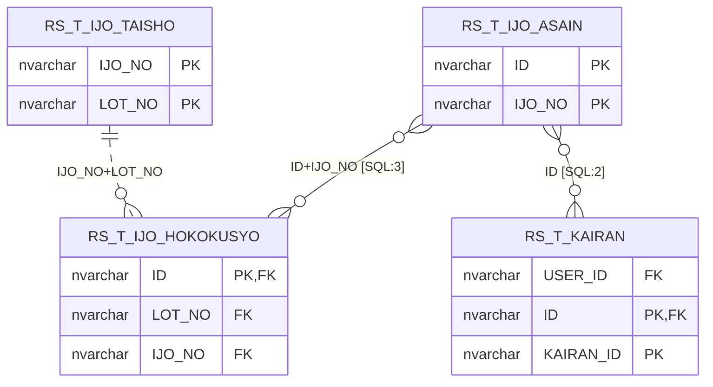
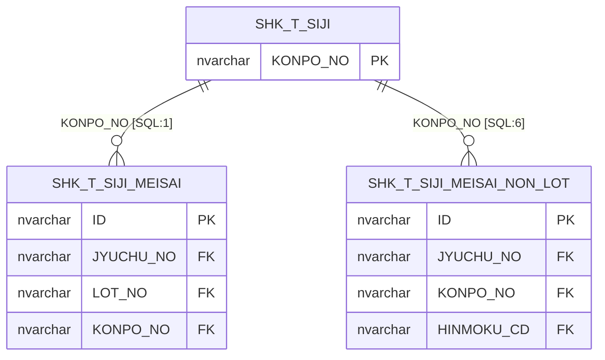
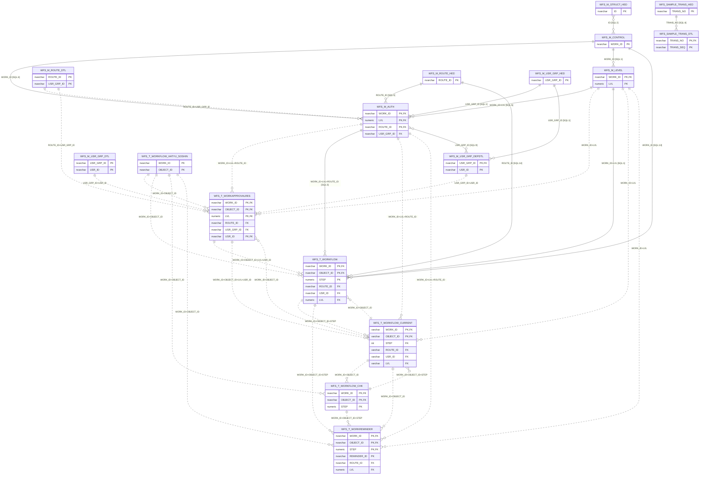

# TALON DB ER図(SQL定義で裏づけ・補強)

- 実線 `||--o{`: 推定関係のうち、アプリのSQLで全キー結合が確認できたもの。ラベルの `[SQL:n]` は使用機能数
- 点線 `||..o{`: 複合PK一致の推定のみ(SQL実績なし)。実際には未使用の可能性がある
- 実線 `}o--o{`: SQLでは結合されているが、PK一致の推定に無かった関係(使用機能2以上のみ)。親子の向きは不明
- 属性は PK と関係に使うFK列のみ。全列は `テーブル定義.md` を参照

| 系統 | 関係数 | うちSQL確認 | テーブル数 |
|---|---|---|---|
| COM_共通系 | 2 | 2 | 4 |
| KOUTEI_工程系 | 5 | 4 | 4 |
| NP_日報系 | 29 | 21 | 30 |
| OTHER_その他 | 5 | 4 | 9 |
| RS_クレーム異常系 | 3 | 2 | 4 |
| SHK_出荷系 | 2 | 2 | 3 |
| SIYO_仕様書系 | 16 | 3 | 17 |
| TLN_TALON基盤系 | 57 | 6 | 25 |
| WFS_ワークフロー系 | 37 | 13 | 17 |
| (系統間) | 89 | 68 | - |

## COM_共通系

## KOUTEI_工程系

## NP_日報系

```mermaid
erDiagram
    NP_T_CHEK_SHEET ||..o{ NP_T_HATSUMONO_INPUT : "LOT_NO+KOTEI_JUN"
    NP_T_HOLDER ||--o{ NP_T_HOLDER_MEN : "HOLDER_NO [SQL:4]"
    NP_T_INPUT_ITAATSU ||--o{ NP_T_INPUT_COMMON : "LOT_NO [SQL:1]"
    NP_T_INPUT_ITAATSU ||--o{ NP_T_TEHAI_RENKEI_KANRI : "LOT_NO [SQL:1]"
    NP_T_INPUT_ITAATSU_HINMOKU_MEISAI ||..o{ NP_T_INPUT_COMMON : "KBN+HINMOKU_CD+LOT_NO"
    NP_T_INPUT_ITAATSU_LOT_HEADER ||--o{ NP_T_INPUT_COMMON : "LOT_NO [SQL:2]"
    NP_T_KAKO ||--o{ NP_T_INPUT_COMMON : "KAKO_ID [SQL:35]"
    NP_T_KAKO ||--o{ NP_T_KAKO_KEIHI_MEISAI : "KAKO_ID [SQL:1]"
    NP_T_KAKO_SORYO ||--o{ NP_T_KAKO_SORYO_MEISAI : "PID [SQL:1]"
    NP_T_KIZAI_SAISAKU ||..o{ NP_T_KIZAI : "LOT_NO+SOUKOUSEI_HINMOKU_NAME+KIZAI_LOT_NO"
    NP_T_KIZAI_SAISAKU ||..o{ NP_T_KIZAI_HARAIDASHI : "LOT_NO+SOUKOUSEI_HINMOKU_NAME+KIZAI_LOT_NO"
    NP_T_KIZAI_SAISAKU ||..o{ NP_T_KIZAI_HARAIDASHI33 : "LOT_NO+SOUKOUSEI_HINMOKU_NAME+KIZAI_LOT_NO"
    NP_T_KOTEI_KANRI ||--o{ NP_T_INPUT_COMMON : "LOT_NO [SQL:3]"
    NP_T_LOT_REPORT ||--o{ NP_T_TEHAI_RENKEI_KANRI : "LOT_NO [SQL:1]"
    NP_T_PRESS_STRUCT_SINGLE ||--o{ NP_T_INPUT_COMMON : "PID [SQL:1]"
    NP_T_TEHAI_RENKEI_KANRI ||--o{ NP_T_INPUT_COMMON : "LOT_NO+SAGYO_KU [SQL:7]"
    NP_T_TEHAI_RENKEI_KANRI ||..o{ NP_T_INPUT_GAIKEI : "LOT_NO+SAGYO_KU"
    NP_T_TEHAI_RENKEI_KANRI ||..o{ NP_T_MOKUSHI : "LOT_NO+SAGYO_KU"
    NP_T_TEHAI_RENKEI_KANRI ||..o{ NP_T_TEHAI_JOHO : "LOT_NO+SAGYO_KU"
    NP_T_TONYU_KIZAI ||--o{ NP_T_INPUT_COMMON : "LOT_NO [SQL:1]"
    NP_T_INPUT_COMMON }o--o{ NP_T_KIZAI_HARAIDASHI : "LOT_NO [SQL:6]"
    NP_T_HOLDER }o--o{ NP_T_HOLDER_FILM : "HINMOKU_NM+HOLDER_NO [SQL:4]"
    NP_T_INPUT_COMMON }o--o{ NP_T_KAKO_BIKO : "ID [SQL:4]"
    NP_T_INPUT_BIKO }o--o{ NP_T_INPUT_COMMON : "ID [SQL:3]"
    NP_T_INPUT_COMMON }o--o{ NP_T_KAKO_KEIHI_MEISAI : "KAKO_ID+LOT_NO [SQL:3]"
    NP_T_KAKO }o--o{ NP_T_KAKO_SORYO : "KAKO_NO [SQL:2]"
    NP_T_INPUT_COMMON }o--o{ NP_T_INPUT_NP : "ID [SQL:2]"
    NP_T_INPUT_COMMON }o--o{ NP_T_FURYO : "ID+LOT_NO [SQL:2]"
    NP_T_MOKUSHI }o--o{ NP_T_MOKUSHI_MEN : "ID [SQL:2]"
    NP_T_CHEK_SHEET {
        nvarchar LOT_NO PK
        numeric KOTEI_JUN PK
    }
    NP_T_FURYO {
        nvarchar LOT_NO FK
        nvarchar FID PK
    }
    NP_T_HATSUMONO_INPUT {
        nvarchar LOT_NO FK
        nvarchar KOTEI_JUN FK
        nvarchar ID PK
    }
    NP_T_HOLDER {
        nvarchar HOLDER_NO PK
    }
    NP_T_HOLDER_FILM {
        nvarchar FILM_HOLDER_NO PK
        nvarchar HINMOKU_NM FK
    }
    NP_T_HOLDER_MEN {
        nvarchar MEN PK
        nvarchar HOLDER_NO PK,FK
    }
    NP_T_INPUT_BIKO {
        nvarchar ID PK
    }
    NP_T_INPUT_COMMON {
        nvarchar ID PK,FK
        nvarchar LOT_NO FK
        nvarchar HINMOKU_CD FK
        nvarchar SAGYO_KU FK
        nvarchar KBN FK
        nvarchar FILE_PATH FK
        numeric SIYOSYO_SEQ FK
        nvarchar SIYOSYO_NO FK
        nvarchar PID FK
        nvarchar KAKO_ID FK
        nvarchar RENBAN FK
    }
    NP_T_INPUT_GAIKEI {
        nvarchar ID PK
        nvarchar LOT_NO FK
        nvarchar SAGYO_KU FK
    }
    NP_T_INPUT_ITAATSU {
        nvarchar LOT_NO PK
        numeric SIYOSYO_SEQ FK
    }
    NP_T_INPUT_ITAATSU_HINMOKU_MEISAI {
        nvarchar KBN PK
        nvarchar HINMOKU_CD PK
        nvarchar LOT_NO PK
    }
    NP_T_INPUT_ITAATSU_LOT_HEADER {
        nvarchar LOT_NO PK
    }
    NP_T_INPUT_NP {
        nvarchar ID PK,FK
    }
    NP_T_KAKO {
        nvarchar KAKO_ID PK
    }
    NP_T_KAKO_BIKO {
        nvarchar ID PK,FK
    }
    NP_T_KAKO_KEIHI_MEISAI {
        nvarchar ID PK
        nvarchar KAKO_ID PK,FK
        nvarchar KEIHI_CD FK
        nvarchar LOT_NO FK
    }
    NP_T_KAKO_SORYO {
        nvarchar PID PK
        nvarchar KAKO_NO FK
    }
    NP_T_KAKO_SORYO_MEISAI {
        nvarchar ID PK
        nvarchar PID PK,FK
    }
    NP_T_KIZAI {
        nvarchar ID PK
        nvarchar LOT_NO FK
        nvarchar SOUKOUSEI_HINMOKU_NAME FK
        nvarchar KIZAI_LOT_NO FK
    }
    NP_T_KIZAI_HARAIDASHI {
        nvarchar LOT_NO FK
        nvarchar SOUKOUSEI_HINMOKU_NAME FK
        nvarchar KIZAI_LOT_NO FK
        nvarchar KIZAI_ID PK
    }
    NP_T_KIZAI_HARAIDASHI33 {
        nvarchar LOT_NO FK
        nvarchar SOUKOUSEI_HINMOKU_NAME FK
        nvarchar KIZAI_LOT_NO FK
    }
    NP_T_KIZAI_SAISAKU {
        nvarchar LOT_NO PK
        nvarchar SOUKOUSEI_HINMOKU_NAME PK
        nvarchar KIZAI_LOT_NO PK
    }
    NP_T_KOTEI_KANRI {
        nvarchar LOT_NO PK
    }
    NP_T_LOT_REPORT {
        nvarchar LOT_NO PK
        numeric SIYOSYO_SEQ FK
    }
    NP_T_MOKUSHI {
        nvarchar ID PK
        nvarchar LOT_NO FK
        nvarchar SAGYO_KU FK
    }
    NP_T_MOKUSHI_MEN {
        nvarchar ID PK,FK
    }
    NP_T_PRESS_STRUCT_SINGLE {
        nvarchar PID PK
    }
    NP_T_TEHAI_JOHO {
        nvarchar LOT_NO PK,FK
        nvarchar TEHAI_DVS PK
        nvarchar SAGYO_KU PK,FK
        date NOUKI_DT PK
        numeric TOUNYU_PCS_SUU PK
        nvarchar KANNOU_DVS PK
    }
    NP_T_TEHAI_RENKEI_KANRI {
        nvarchar LOT_NO PK,FK
        nvarchar SAGYO_KU PK
        int SIYOSYO_SEQ FK
        numeric JYUCHU_NO FK
    }
    NP_T_TONYU_KIZAI {
        nvarchar LOT_NO PK
    }
```

## OTHER_その他

## RS_クレーム異常系

## SHK_出荷系

## SIYO_仕様書系

```mermaid
erDiagram
    SIYO20010 ||..o{ SIYO_CHK_DATA_MEISAI : "SIYOSYO_NO+FILE_PATH"
    SIYO20012 ||..o{ SIYO2001 : "SIYOSYO_NO+TEXT"
    SIYO4001 ||..o{ SIYO4002 : "SIYOSYO_NO+CHK_ID"
    SIYO4001 ||..o{ SIYO_CHK_DATA_MEISAI : "SIYOSYO_NO+CHK_ID"
    SIYOM001 ||--o{ SIYOM002 : "BLOCK_ID [SQL:2]"
    SIYOM010 ||..o{ SIYOM013 : "SOUSU+HYOMEN_SYORI_CD+KOUTEI_CD"
    SIYO_CHK_DATA ||..o{ SIYO4002 : "SIYOSYO_NO+CHK_ID"
    SIYO_CHK_DATA ||..o{ SIYO_CHK_DATA_MEISAI : "SIYOSYO_NO+CHK_ID"
    SIYO_SEIZO_JKN ||..o{ SIYO_SEIZO_JKN_MEISAI : "SIYOSYO_SEQ+KOUTEI_SEQ"
    SIYO_SEIZO_JKN ||..o{ SIYO_SEIZO_JKN_MEISAI2 : "SIYOSYO_SEQ+KOUTEI_SEQ"
    SIYO_SEIZO_JKN ||..o{ SIYO_SEIZO_JKN_MEISAI3 : "SIYOSYO_SEQ+KOUTEI_SEQ"
    SIYO_SEIZO_JKN_HEADER ||..o{ SIYO_SEIZO_JKN_MEISAI : "SIYOSYO_SEQ+KOUTEI_SEQ"
    SIYO_SEIZO_JKN_HEADER ||..o{ SIYO_SEIZO_JKN_MEISAI2 : "SIYOSYO_SEQ+KOUTEI_SEQ"
    SIYO_SEIZO_JKN_HEADER ||..o{ SIYO_SEIZO_JKN_MEISAI3 : "SIYOSYO_SEQ+KOUTEI_SEQ"
    SIYO20012 }o--o{ SIYOM001 : "TEXT [SQL:3]"
    SIYOM0040 }o--o{ SIYO4001 : "ID [SQL:2]"
    SIYO2001 {
        nvarchar SIYOSYO_NO PK,FK
        nvarchar BLOCK_ID PK
        nvarchar TEXT FK
    }
    SIYO20010 {
        nvarchar SIYOSYO_NO PK
        nvarchar FILE_PATH PK
    }
    SIYO20012 {
        nvarchar SIYOSYO_NO PK
        nvarchar TEXT PK
    }
    SIYO4001 {
        nvarchar SIYOSYO_NO PK
        nvarchar CHK_ID PK
    }
    SIYO4002 {
        nvarchar SIYOSYO_NO PK,FK
        nvarchar CHK_ID PK,FK
        nvarchar MEISAI_ID PK
    }
    SIYOM001 {
        nvarchar BLOCK_ID PK
    }
    SIYOM002 {
        nvarchar TOKUSYU_ID PK
        nvarchar BLOCK_ID PK,FK
    }
    SIYOM0040 {
        nvarchar ID PK
    }
    SIYOM010 {
        numeric SOUSU PK
        nvarchar HYOMEN_SYORI_CD PK
        nvarchar KOUTEI_CD PK
    }
    SIYOM013 {
        numeric SOUSU PK,FK
        nvarchar HYOMEN_SYORI_CD PK,FK
        nvarchar KOUTEI_CD PK,FK
        nvarchar SIYO_IVH_FLG PK
    }
    SIYO_CHK_DATA {
        nvarchar SIYOSYO_NO PK
        nvarchar CHK_ID PK
    }
    SIYO_CHK_DATA_MEISAI {
        nvarchar SIYOSYO_NO PK,FK
        nvarchar MEISAI_ID PK
        nvarchar CHK_ID PK,FK
        nvarchar FILE_PATH FK
    }
    SIYO_SEIZO_JKN {
        decimal SIYOSYO_SEQ PK
        decimal KOUTEI_SEQ PK
    }
    SIYO_SEIZO_JKN_HEADER {
        decimal SIYOSYO_SEQ PK
        decimal KOUTEI_SEQ PK
    }
    SIYO_SEIZO_JKN_MEISAI {
        decimal SIYOSYO_SEQ PK,FK
        decimal KOUTEI_SEQ PK,FK
        int GYOSU PK
    }
    SIYO_SEIZO_JKN_MEISAI2 {
        decimal SIYOSYO_SEQ PK,FK
        decimal KOUTEI_SEQ PK,FK
        int GYOSU PK
    }
    SIYO_SEIZO_JKN_MEISAI3 {
        decimal SIYOSYO_SEQ PK,FK
        decimal KOUTEI_SEQ PK,FK
        int GYOSU PK
    }
```

## TLN_TALON基盤系

```mermaid
erDiagram
    TLN_B_GENERAL_APP ||..o{ TLN_B_GENERAL_ITEM_OPTN : "BRANCHES_ID+FUNC_ID+FUNC_SEQ+FUNC_KBN"
    TLN_B_GENERAL_APP ||..o{ TLN_B_GENERAL_USES : "BRANCHES_ID+FUNC_ID+FUNC_SEQ+FUNC_KBN"
    TLN_B_GENERAL_FUNC ||..o{ TLN_B_GENERAL_APP : "BRANCHES_ID+FUNC_ID"
    TLN_B_GENERAL_FUNC ||..o{ TLN_B_GENERAL_AUTH : "BRANCHES_ID+FUNC_ID"
    TLN_B_GENERAL_FUNC ||..o{ TLN_B_GENERAL_FUNC_SQL : "BRANCHES_ID+FUNC_ID"
    TLN_B_GENERAL_FUNC ||..o{ TLN_B_GENERAL_ITEM : "BRANCHES_ID+FUNC_ID"
    TLN_B_GENERAL_FUNC ||..o{ TLN_B_GENERAL_ITEM_OPTN : "BRANCHES_ID+FUNC_ID"
    TLN_B_GENERAL_FUNC ||..o{ TLN_B_GENERAL_POSITION : "BRANCHES_ID+FUNC_ID"
    TLN_B_GENERAL_FUNC ||..o{ TLN_B_GENERAL_SQL_ANALYZE : "BRANCHES_ID+FUNC_ID"
    TLN_B_GENERAL_FUNC ||..o{ TLN_B_GENERAL_USES : "BRANCHES_ID+FUNC_ID"
    TLN_B_GENERAL_FUNC_SQL ||..o{ TLN_B_GENERAL_APP : "BRANCHES_ID+FUNC_ID+FUNC_SEQ"
    TLN_B_GENERAL_FUNC_SQL ||..o{ TLN_B_GENERAL_ITEM : "BRANCHES_ID+FUNC_ID+FUNC_SEQ"
    TLN_B_GENERAL_FUNC_SQL ||..o{ TLN_B_GENERAL_ITEM_OPTN : "BRANCHES_ID+FUNC_ID+FUNC_SEQ"
    TLN_B_GENERAL_FUNC_SQL ||..o{ TLN_B_GENERAL_POSITION : "BRANCHES_ID+FUNC_ID+FUNC_SEQ"
    TLN_B_GENERAL_FUNC_SQL ||..o{ TLN_B_GENERAL_SQL_ANALYZE : "BRANCHES_ID+FUNC_ID+FUNC_SEQ"
    TLN_B_GENERAL_FUNC_SQL ||..o{ TLN_B_GENERAL_USES : "BRANCHES_ID+FUNC_ID+FUNC_SEQ"
    TLN_B_GENERAL_ITEM ||..o{ TLN_B_GENERAL_FUNC_SQL : "BRANCHES_ID+FUNC_ID+FUNC_SEQ+SORT"
    TLN_B_GENERAL_ITEM ||..o{ TLN_B_GENERAL_POSITION : "BRANCHES_ID+FUNC_ID+FUNC_SEQ+SORT"
    TLN_M_AUTHORITY ||--o{ TLN_M_FUNCTION : "FUNC_ATH_ID [SQL:1]"
    TLN_M_FUNCTION ||..o{ TLN_B_GENERAL_AUTH : "FUNC_ATH_ID+FUNC_ID"
    TLN_M_GENERAL_APP ||..o{ TLN_ANALYZE_INFO : "FUNC_ID+FUNC_SEQ+FUNC_KBN"
    TLN_M_GENERAL_APP ||..o{ TLN_ANALYZE_INFO_LOG : "FUNC_ID+FUNC_SEQ+FUNC_KBN"
    TLN_M_GENERAL_APP ||..o{ TLN_B_GENERAL_APP : "FUNC_ID+FUNC_SEQ+FUNC_KBN"
    TLN_M_GENERAL_APP ||..o{ TLN_B_GENERAL_ITEM_OPTN : "FUNC_ID+FUNC_SEQ+FUNC_KBN"
    TLN_M_GENERAL_APP ||..o{ TLN_B_GENERAL_USES : "FUNC_ID+FUNC_SEQ+FUNC_KBN"
    TLN_M_GENERAL_APP ||..o{ TLN_M_GENERAL_ITEM_OPTN : "FUNC_ID+FUNC_SEQ+FUNC_KBN"
    TLN_M_GENERAL_APP ||..o{ TLN_M_GENERAL_USES : "FUNC_ID+FUNC_SEQ+FUNC_KBN"
    TLN_M_GENERAL_AUTH ||..o{ TLN_B_GENERAL_AUTH : "FUNC_ID+FUNC_ATH_ID"
    TLN_M_GENERAL_FUNC ||--o{ TLN_M_GENERAL_FUNC_SQL : "FUNC_ID [SQL:2]"
    TLN_M_GENERAL_FUNC ||--o{ TLN_M_GENERAL_ITEM_OPTN : "FUNC_ID [SQL:1]"
    TLN_M_GENERAL_FUNC_SQL ||..o{ TLN_ANALYZE_INFO : "FUNC_ID+FUNC_SEQ"
    TLN_M_GENERAL_FUNC_SQL ||..o{ TLN_ANALYZE_INFO_LOG : "FUNC_ID+FUNC_SEQ"
    TLN_M_GENERAL_FUNC_SQL ||..o{ TLN_B_GENERAL_APP : "FUNC_ID+FUNC_SEQ"
    TLN_M_GENERAL_FUNC_SQL ||..o{ TLN_B_GENERAL_FUNC_SQL : "FUNC_ID+FUNC_SEQ"
    TLN_M_GENERAL_FUNC_SQL ||..o{ TLN_B_GENERAL_ITEM : "FUNC_ID+FUNC_SEQ"
    TLN_M_GENERAL_FUNC_SQL ||..o{ TLN_B_GENERAL_ITEM_OPTN : "FUNC_ID+FUNC_SEQ"
    TLN_M_GENERAL_FUNC_SQL ||..o{ TLN_B_GENERAL_POSITION : "FUNC_ID+FUNC_SEQ"
    TLN_M_GENERAL_FUNC_SQL ||..o{ TLN_B_GENERAL_SQL_ANALYZE : "FUNC_ID+FUNC_SEQ"
    TLN_M_GENERAL_FUNC_SQL ||..o{ TLN_B_GENERAL_USES : "FUNC_ID+FUNC_SEQ"
    TLN_M_GENERAL_FUNC_SQL ||--o{ TLN_M_GENERAL_APP : "FUNC_ID+FUNC_SEQ [SQL:2]"
    TLN_M_GENERAL_FUNC_SQL ||--o{ TLN_M_GENERAL_ITEM : "FUNC_ID+FUNC_SEQ [SQL:2]"
    TLN_M_GENERAL_FUNC_SQL ||--o{ TLN_M_GENERAL_ITEM_OPTN : "FUNC_ID+FUNC_SEQ [SQL:1]"
    TLN_M_GENERAL_FUNC_SQL ||..o{ TLN_M_GENERAL_POSITION : "FUNC_ID+FUNC_SEQ"
    TLN_M_GENERAL_FUNC_SQL ||..o{ TLN_M_GENERAL_SQL_ANALYZE : "FUNC_ID+FUNC_SEQ"
    TLN_M_GENERAL_FUNC_SQL ||..o{ TLN_M_GENERAL_USES : "FUNC_ID+FUNC_SEQ"
    TLN_M_GENERAL_FUNC_SQL ||..o{ TLN_M_SPEC_GRAPH : "FUNC_ID+FUNC_SEQ"
    TLN_M_GENERAL_ITEM ||..o{ TLN_B_GENERAL_FUNC_SQL : "FUNC_ID+FUNC_SEQ+SORT"
    TLN_M_GENERAL_ITEM ||..o{ TLN_B_GENERAL_ITEM : "FUNC_ID+FUNC_SEQ+SORT"
    TLN_M_GENERAL_ITEM ||..o{ TLN_B_GENERAL_POSITION : "FUNC_ID+FUNC_SEQ+SORT"
    TLN_M_GENERAL_ITEM ||..o{ TLN_M_GENERAL_FUNC_SQL : "FUNC_ID+FUNC_SEQ+SORT"
    TLN_M_GENERAL_ITEM ||..o{ TLN_M_GENERAL_POSITION : "FUNC_ID+FUNC_SEQ+SORT"
    TLN_M_GENERAL_ITEM_OPTN ||..o{ TLN_ANALYZE_INFO : "FUNC_ID+FUNC_SEQ+COL_NAME+FUNC_KBN+OPT_SORT"
    TLN_M_GENERAL_ITEM_OPTN ||..o{ TLN_ANALYZE_INFO_LOG : "FUNC_ID+FUNC_SEQ+COL_NAME+FUNC_KBN+OPT_SORT"
    TLN_M_GENERAL_ITEM_OPTN ||..o{ TLN_B_GENERAL_ITEM_OPTN : "FUNC_ID+FUNC_SEQ+COL_NAME+FUNC_KBN+OPT_SORT"
    TLN_M_GENERAL_POSITION ||..o{ TLN_B_GENERAL_POSITION : "FUNC_ID+SCOPE+ATTR_KBN+POS+SORT"
    TLN_M_GENERAL_POSITION ||..o{ TLN_M_SPEC_DESIGN : "FUNC_ID+SCOPE+ATTR_KBN+POS+SORT"
    TLN_M_SPEC_GRAPH ||..o{ TLN_M_SPEC_PLOT : "FUNC_ID+BLOC_NO+SERIES_NO"
    TLN_ANALYZE_INFO {
        nvarchar FUNC_ID PK,FK
        numeric FUNC_SEQ PK,FK
        nvarchar FUNC_KBN PK,FK
        nvarchar COL_NAME PK,FK
        numeric OPT_SORT PK,FK
        nvarchar EVENT_TYPE PK
        nvarchar DATA_TYPE PK
        numeric MOCK_SEQ PK
        numeric SEQ PK
    }
    TLN_ANALYZE_INFO_LOG {
        nvarchar FUNC_ID PK,FK
        numeric FUNC_SEQ PK,FK
        nvarchar FUNC_KBN PK,FK
        nvarchar COL_NAME PK,FK
        numeric OPT_SORT PK,FK
        nvarchar EVENT_TYPE PK
        nvarchar DATA_TYPE PK
        numeric MOCK_SEQ PK
        numeric SEQ PK
    }
    TLN_B_GENERAL_APP {
        nvarchar BRANCHES_ID PK,FK
        nvarchar FUNC_ID PK,FK
        numeric FUNC_SEQ PK,FK
        nvarchar FUNC_KBN PK,FK
    }
    TLN_B_GENERAL_AUTH {
        nvarchar BRANCHES_ID PK,FK
        nvarchar FUNC_ID PK,FK
        nvarchar FUNC_ATH_ID PK,FK
    }
    TLN_B_GENERAL_FUNC {
        nvarchar BRANCHES_ID PK
        nvarchar FUNC_ID PK
    }
    TLN_B_GENERAL_FUNC_SQL {
        nvarchar BRANCHES_ID PK,FK
        nvarchar FUNC_ID PK,FK
        numeric FUNC_SEQ PK,FK
        numeric SORT FK
    }
    TLN_B_GENERAL_ITEM {
        nvarchar BRANCHES_ID PK,FK
        nvarchar FUNC_ID PK,FK
        numeric FUNC_SEQ PK,FK
        numeric SORT PK,FK
    }
    TLN_B_GENERAL_ITEM_OPTN {
        nvarchar BRANCHES_ID PK,FK
        nvarchar FUNC_ID PK,FK
        numeric FUNC_SEQ PK,FK
        nvarchar COL_NAME PK,FK
        nvarchar FUNC_KBN PK,FK
        numeric OPT_SORT PK,FK
    }
    TLN_B_GENERAL_POSITION {
        nvarchar BRANCHES_ID PK,FK
        nvarchar FUNC_ID PK,FK
        nvarchar SCOPE PK,FK
        nvarchar ATTR_KBN PK,FK
        nvarchar POS PK,FK
        numeric SORT PK,FK
        numeric FUNC_SEQ FK
    }
    TLN_B_GENERAL_SQL_ANALYZE {
        nvarchar BRANCHES_ID PK,FK
        nvarchar FUNC_ID PK,FK
        numeric FUNC_SEQ PK,FK
        nvarchar DIVISION PK
        numeric SEQ PK
        numeric SRC_SEQ PK
    }
    TLN_B_GENERAL_USES {
        nvarchar BRANCHES_ID PK,FK
        nvarchar FUNC_ID PK,FK
        numeric FUNC_SEQ PK,FK
        nvarchar FUNC_KBN PK,FK
        nvarchar USER_CODE PK
        numeric SEQ PK
        nvarchar KEY_CODE PK
    }
    TLN_M_AUTHORITY {
        nvarchar FUNC_ATH_ID PK
    }
    TLN_M_FUNCTION {
        nvarchar FUNC_ATH_ID PK,FK
        nvarchar FUNC_ID PK
    }
    TLN_M_GENERAL_APP {
        nvarchar FUNC_ID PK,FK
        numeric FUNC_SEQ PK,FK
        nvarchar FUNC_KBN PK
    }
    TLN_M_GENERAL_AUTH {
        nvarchar FUNC_ID PK
        nvarchar FUNC_ATH_ID PK
    }
    TLN_M_GENERAL_FUNC {
        nvarchar FUNC_ID PK
    }
    TLN_M_GENERAL_FUNC_SQL {
        nvarchar FUNC_ID PK,FK
        numeric FUNC_SEQ PK,FK
        numeric SORT FK
    }
    TLN_M_GENERAL_ITEM {
        nvarchar FUNC_ID PK,FK
        numeric FUNC_SEQ PK,FK
        numeric SORT PK
    }
    TLN_M_GENERAL_ITEM_OPTN {
        nvarchar FUNC_ID PK,FK
        numeric FUNC_SEQ PK,FK
        nvarchar COL_NAME PK
        nvarchar FUNC_KBN PK,FK
        numeric OPT_SORT PK
    }
    TLN_M_GENERAL_POSITION {
        nvarchar FUNC_ID PK,FK
        nvarchar SCOPE PK
        nvarchar ATTR_KBN PK
        nvarchar POS PK
        numeric SORT PK,FK
        numeric FUNC_SEQ FK
    }
    TLN_M_GENERAL_SQL_ANALYZE {
        nvarchar FUNC_ID PK,FK
        numeric FUNC_SEQ PK,FK
        nvarchar DIVISION PK
        numeric SEQ PK
        numeric SRC_SEQ PK
    }
    TLN_M_GENERAL_USES {
        nvarchar FUNC_ID PK,FK
        numeric FUNC_SEQ PK,FK
        nvarchar FUNC_KBN PK,FK
        nvarchar USER_CODE PK
        numeric SEQ PK
        nvarchar KEY_CODE PK
    }
    TLN_M_SPEC_DESIGN {
        nvarchar FUNC_ID PK,FK
        numeric DESIGN_NO PK
        nvarchar SCOPE FK
        nvarchar ATTR_KBN FK
        nvarchar POS FK
        numeric SORT FK
    }
    TLN_M_SPEC_GRAPH {
        nvarchar FUNC_ID PK,FK
        numeric FUNC_SEQ FK
        numeric BLOC_NO PK
        numeric SERIES_NO PK
    }
    TLN_M_SPEC_PLOT {
        nvarchar FUNC_ID PK,FK
        numeric PLOT_NO PK
        numeric BLOC_NO FK
        numeric SERIES_NO PK,FK
    }
```

## WFS_ワークフロー系

## 系統間の関係

| 親 | 子 | 結合列 | 状態 | 使用機能数 |
|---|---|---|---|---|
| COM_M_GAITYU_KEIHI | NP_T_KAKO_KEIHI_MEISAI | KEIHI_CD | SQL確認 | 7 |
| COM_M_HINMOKU | NP_T_INPUT_COMMON | HINMOKU_CD | SQL確認 | 2 |
| COM_M_HINMOKU | SHK_T_SIJI_MEISAI_NON_LOT | HINMOKU_CD | SQL確認 | 2 |
| COM_M_HINMOKU | SIYOSYO_MAIN | HINMOKU_CD | SQL確認 | 5 |
| COM_M_KOUTEI | KOUTEIJUN_KANRI | KOUTEI_CD | SQL確認 | 2 |
| COM_M_USER | NP_T_SAGYOSYA | USER_ID | SQL確認 | 1 |
| COM_M_USER | RS_T_KAIRAN | USER_ID | SQL確認 | 1 |
| COM_T_TYUI_HYOJI | NP_T_TEHAI_RENKEI_KANRI | LOT_NO,JYUCHU_NO | 推定のみ | 0 |
| COM_T_TYUI_HYOJI | SHK_T_SIJI_MEISAI | LOT_NO,JYUCHU_NO | 推定のみ | 0 |
| COM_T_TYUI_HYOJI | SIYO_T_SEIZOSASHIZUSYO | LOT_NO,JYUCHU_NO | 推定のみ | 0 |
| KOUTEIJUN_KANRI | NP_T_KOUTEI_SINTYOKU | SIYOSYO_SEQ,KOUTEI_SEQ | 推定のみ | 0 |
| KOUTEIJUN_KANRI | SIYO_SEIZO_JKN_MEISAI | SIYOSYO_SEQ,KOUTEI_SEQ | 推定のみ | 0 |
| KOUTEIJUN_KANRI | SIYO_SEIZO_JKN_MEISAI2 | SIYOSYO_SEQ,KOUTEI_SEQ | 推定のみ | 0 |
| KOUTEIJUN_KANRI | SIYO_SEIZO_JKN_MEISAI3 | SIYOSYO_SEQ,KOUTEI_SEQ | 推定のみ | 0 |
| KOUTEI_MEISAI_SIYOSYO | NP_T_KOUTEI_SINTYOKU | SIYOSYO_SEQ,KOUTEI_SEQ | 推定のみ | 0 |
| KOUTEI_MEISAI_SIYOSYO | SIYO_SEIZO_JKN_MEISAI | SIYOSYO_SEQ,KOUTEI_SEQ | 推定のみ | 0 |
| KOUTEI_MEISAI_SIYOSYO | SIYO_SEIZO_JKN_MEISAI2 | SIYOSYO_SEQ,KOUTEI_SEQ | 推定のみ | 0 |
| KOUTEI_MEISAI_SIYOSYO | SIYO_SEIZO_JKN_MEISAI3 | SIYOSYO_SEQ,KOUTEI_SEQ | 推定のみ | 0 |
| NP_T_LOT_REPORT | O7ISCHEDULE | LOT_NO | SQL確認 | 3 |
| NP_T_LOT_REPORT | SHK_T_SIJI_MEISAI | LOT_NO | SQL確認 | 1 |
| O7ISCHEDULE | NP_T_TEHAI_RENKEI_KANRI | LOT_NO,JYUCHU_NO | 推定のみ | 0 |
| O7ISCHEDULE | SHK_T_SIJI_MEISAI | LOT_NO,JYUCHU_NO | 推定のみ | 0 |
| O7ISCHEDULE | SIYO_T_SEIZOSASHIZUSYO | LOT_NO,JYUCHU_NO | 推定のみ | 0 |
| SIYO20010 | NP_T_INPUT_COMMON | SIYOSYO_NO,FILE_PATH | 推定のみ | 0 |
| SIYO20011 | NP_T_INPUT_COMMON | SIYOSYO_NO,RENBAN | 推定のみ | 0 |
| SIYO20012 | T_SIYOSYO_COMBINED | SIYOSYO_NO,TEXT | 推定のみ | 0 |
| SIYOSYO_MAIN | KOUTEIJUN_KANRI | SIYOSYO_SEQ | SQL確認 | 10 |
| SIYOSYO_MAIN | KOUTEI_MEISAI_SIYOSYO | SIYOSYO_SEQ | SQL確認 | 6 |
| SIYOSYO_MAIN | NP_T_INPUT_COMMON | SIYOSYO_SEQ | SQL確認 | 14 |
| SIYOSYO_MAIN | NP_T_INPUT_ITAATSU | SIYOSYO_SEQ | SQL確認 | 1 |
| SIYOSYO_MAIN | NP_T_LOT_REPORT | SIYOSYO_SEQ | SQL確認 | 1 |
| SIYOSYO_MAIN | NP_T_TEHAI_RENKEI_KANRI | SIYOSYO_SEQ | SQL確認 | 6 |
| SIYOSYO_MAIN | O7ISCHEDULE | SIYOSYO_SEQ | SQL確認 | 29 |
| SIYOSYO_MAIN | SOUKOUSEI_KANRI | SIYOSYO_SEQ | SQL確認 | 7 |
| SIYO_SEIZO_JKN | KOUTEI_MEISAI_KOUMOKU | SIYOSYO_SEQ,KOUTEI_SEQ | 推定のみ | 0 |
| SIYO_SEIZO_JKN | NP_T_KOUTEI_SINTYOKU | SIYOSYO_SEQ,KOUTEI_SEQ | 推定のみ | 0 |
| SIYO_SEIZO_JKN_HEADER | KOUTEI_MEISAI_KOUMOKU | SIYOSYO_SEQ,KOUTEI_SEQ | 推定のみ | 0 |
| SIYO_SEIZO_JKN_HEADER | NP_T_KOUTEI_SINTYOKU | SIYOSYO_SEQ,KOUTEI_SEQ | 推定のみ | 0 |
| RS_T_CLAIM | NP_T_FILE | ID | SQLのみ | 59 |
| COM_M_USER | NP_T_INPUT_COMMON | USER_ID | SQLのみ | 51 |
| COM_M_TYUIKANKI | CON_T_FILE | ID | SQLのみ | 49 |
| NP_T_KAKO | TLN_M_HANYO_CLASS | KAKO_IRAI_SYO_KBN | SQLのみ | 39 |
| RS_T_IJO_HOKOKUSYO | WFS_T_WORKFLOW | ID+IJO_NO+LOT_NO+WORK_ID | SQLのみ | 34 |
| RS_T_IJO_HOKOKUSYO | NP_T_IJO_KAKUNIN | ID | SQLのみ | 32 |
| NP_T_KAKO | WFS_T_WORKFLOW | KAKO_ID | SQLのみ | 28 |
| COM_M_TOKUISAKI | NP_T_KAKO | TOKUISAKI_CD | SQLのみ | 24 |
| KBN_MST | SIYOSYO_MAIN | KBN_CD_S | SQLのみ | 18 |
| KOUTEIJUN_KANRI | O7ISCHEDULE | SIYOSYO_SEQ | SQLのみ | 15 |
| SIYOSYO_MAIN | TLN_M_HANYO_CODE_MAIN | NAISOU1+WORK_SIZE | SQLのみ | 14 |
| TLN_M_USER | WFS_T_WORKFLOW | USER_ID | SQLのみ | 12 |
| KOUTEIJUN_KANRI | NP_T_TEHAI_RENKEI_KANRI | KOUTEI_CD+SIYOSYO_SEQ | SQLのみ | 11 |
| COM_M_USER | NP_T_DRILL | USER_ID | SQLのみ | 9 |
| KOUTEI_MEISAI_SIYOSYO | O7ISCHEDULE | SIYOSYO_SEQ | SQLのみ | 9 |
| TLN_M_USER | NP_T_INPUT_COMMON | USER_ID | SQLのみ | 8 |
| TLN_M_USER | RS_T_HYOJUN_SEISEKI | USER_ID | SQLのみ | 8 |
| KOUTEI_MEISAI_SIYOSYO | NP_T_TEHAI_RENKEI_KANRI | SIYOSYO_SEQ | SQLのみ | 8 |
| KOUTEIJUN_KANRI | O7ISCHEDULE_MEISAI | KOUTEI_CD | SQLのみ | 8 |
| TLN_M_GENERAL_FUNC | NP_T_INPUT_COMMON | FUNC_ID | SQLのみ | 7 |
| NP_T_INPUT_COMMON | O7ISCHEDULE | LOT_NO | SQLのみ | 6 |
| TLN_M_USER | COM_M_TYUIKANKI | USER_ID | SQLのみ | 6 |
| COM_M_USER | NP_T_PRESS_STRUCT_SINGLE | USER_ID | SQLのみ | 5 |
| COM_M_USER | NP_T_MOKUSHI_MEN | USER_ID | SQLのみ | 5 |
| COM_M_USER | RS_T_IJO_HOKOKUSYO | USER_ID | SQLのみ | 5 |
| TLN_M_USER | WFS_M_USR_GRP_DEPDTL | USER_ID | SQLのみ | 5 |
| TLN_M_USER | RS_T_FUTEKIGO | USER_ID | SQLのみ | 4 |
| NP_T_KAKO_SORYO | WFS_T_WORKFLOW | PID+WORK_ID | SQLのみ | 4 |
| COM_M_KOUTEI | NP_T_INPUT_COMMON | KOUTEI_CD | SQLのみ | 3 |
| TLN_M_USER | COM_M_HINMOKU | USER_ID | SQLのみ | 3 |
| NP_T_INPUT_COMMON | WFS_T_WORKFLOW | ID | SQLのみ | 3 |
| O7ISCHEDULE | SHK_T_SIJI_MEISAI_NON_LOT | JYUCHU_NO | SQLのみ | 3 |
| TLN_M_USER | SHK_T_UTIBAKO | USER_ID | SQLのみ | 3 |
| TLN_M_USER | SIYOM001 | USER_ID | SQLのみ | 3 |
| NP_T_TEHAI_JOHO | O7ISCHEDULE | LOT_NO | SQLのみ | 2 |
| COM_M_USER | NP_T_NAISO_CHECK | USER_ID | SQLのみ | 2 |
| TLN_M_GENERAL_FUNC | NP_T_MOKUSHI | FUNC_ID | SQLのみ | 2 |
| COM_M_USER | NP_T_INPUT_GAIKEI | USER_ID | SQLのみ | 2 |
| NIPPOU_T0000MS_Tanka | NP_T_KIZAI_HARAIDASHI | ITEMCD | SQLのみ | 2 |
| O7ISCHEDULE | RS_T_IJO_HOKOKUSYO | LOT_NO | SQLのみ | 2 |
| RS_T_IJO_ASAIN | WFS_T_WORKFLOW | ID+MAXLVL+WORK_ID | SQLのみ | 2 |
| COM_M_TOKUISAKI | SHK_T_SIJI_MEISAI_NON_LOT | TOKUISAKI_CD | SQLのみ | 2 |
| IRAI_T_SAI_FLAX | SIYOSYO_MAIN | HINMOKU_NM | SQLのみ | 2 |
| COM_M_USER | IRAI_T_SAI_FLAX | USER_ID | SQLのみ | 2 |
| COM_M_TOKUISAKI | SHK_T_SIJI | TOKUISAKI_CD | SQLのみ | 2 |
| COM_M_TOKUISAKI | O7ISCHEDULE | TOKUISAKI_CD | SQLのみ | 2 |
| TLN_M_USER | SIYO20010 | USER_ID | SQLのみ | 2 |
| TLN_M_USER | SIYO20011 | USER_ID | SQLのみ | 2 |
| TLN_M_USER | SIYOM0040 | USER_ID | SQLのみ | 2 |
| TLN_M_USER | WFS_M_USR_ADMIN | USER_ID | SQLのみ | 2 |
| TLN_M_USER | WFS_M_USR_DAIRI | USER_ID | SQLのみ | 2 |
